# 지하 콘크리트 구조물 표면 결함 탐지 — YOLOv8-Seg 인스턴스 세그멘테이션과 클래스별 임계값

대구가톨릭대학교 「딥러닝프로그래밍」 Step 3 과제 (20118701 신재윤)

- 바탕 논문: Yong Hwan Kim, Jung Hun Kim, Suk Min Kong, Seong Won Lee, Sang-Il Choi. *Detection and Segmentation of Multiple Surface Defects in Underground Concrete Structures Using YOLOv8s-Seg.* (대구가톨릭대학교 컴퓨터소프트웨어학부 · 한국건설기술연구원 지반연구본부)
- 데이터: 논문의 최종 데이터셋 `yolo_seg_3_clean_v4_2` (AI Hub 지하 콘크리트 구조물 영상을 세 결함으로 다시 주석한 것, 강의에서 배포)
- 대상 결함: **crack**(균열) · **efflorescence**(백태) · **spall_detach**(박리·박락)

## 한눈에 보는 결과

| 항목 | 논문 (YOLOv8s-Seg) | 본 실습 (YOLOv8n-Seg) |
|---|---|---|
| 테스트 mask mAP50 | 0.443 | **0.615** |
| 테스트 mask mAP50-95 | 0.222 | **0.285** |
| 클래스별 mask mAP50 (crack / efflorescence / spall_detach) | – | 0.407 / 0.641 / 0.797 |
| 검증셋에서 고른 임계값 (crack / efflorescence / spall_detach) | 0.010 / 0.004 / 0.060 | **0.10 / 0.06 / 0.20** |
| 테스트 이미지 단위 ON/OFF F1 (crack / efflorescence / spall_detach) | 0.880 / 0.880 / 0.929 | 0.880 / 0.897 / 0.897 |
| **테스트 macro F1** | 0.896 | **0.891** |
| 테스트 오류 (FP / FN, 40장 × 3클래스) | 3 / 5 | 6 / 3 |
| 학습 데이터 | train 4,036장 | **train 3,890장** (누수·중복·빈 파일 146장 제외) |
| 학습 | 60 epoch | 31 epoch에서 조기 종료, 214분 (Apple M4, MPS) |

- 모델 크기(s → n)와 학습 데이터(146장 제외)가 논문과 달라서 **논문 수치는 참고값이고 직접 비교 대상이 아니다.** 다르게 나온 부분은 4절 "논문과 결과가 다르게 나온 이유"에서 다룬다.
- 논문의 핵심 관찰은 그대로 나타났다. 균열은 마스크 점수(mAP50 0.407)가 가장 낮지만, 영상에 균열이 있는지 없는지만 보면 F1이 0.880이다. **경계를 정확히 그리는 능력과 결함이 있는 영상을 골라내는 능력은 다르다.**
- 임계값은 검증셋에서만 정했고 테스트셋에는 한 번, 그대로 적용했다(1.4절, `scripts/week_3.ipynb`의 셀 순서).

용어: **mask mAP** = 예측 마스크와 정답 마스크의 겹침으로 채점한 점수. **ON/OFF 평가** = 마스크 경계는 따지지 않고, 영상에 그 결함이 있는지 없는지만 채점하는 방식. **임계값** = 예측을 채택할 최소 신뢰도.

3주차 최종 제출물과 리포트 7개 항목이 이 README의 어디에 있는지:

| 제출물 | 위치 |
|---|---|
| ① 리포트 | 이 README |
| ② 주석 기준서 | [scripts/report/week_1/annotation_guideline.md](scripts/report/week_1/annotation_guideline.md) (요약은 1.2) |
| ③ 세그멘테이션 성능 (mask mAP50 · mAP50-95, 클래스별) | 2.1 |
| ④ 임계값 F1 곡선 + 선택한 임계값과 근거 | 2.2 |
| ⑤ ON/OFF 결과표 (TP·FP·FN·TN·Precision·Recall·F1, macro F1) | 2.3 |
| ⑥ 오류 사례 (클래스별 FP·FN + 원인) | 3 |

| 리포트 항목 | 위치 |
|---|---|
| 1. 문제 정의 | 1.1 |
| 2. 데이터 (주석 기준 · 규모 · 클래스 구성 · 분할) | 1.2 |
| 3. 방법 (모델 · 학습 설정 · 증강) | 1.3 |
| 4. 결과 | 2 |
| 5. 오류 분석 | 3 |
| 6. 한계 | 4 |
| 7. 재현 정보 (환경 · seed · 실행 순서) | 1.5, 5 |

---

## 1. 코드 설명

### 1.1 문제 정의

터널·공동구 같은 지하 콘크리트 구조물의 표면 영상에서 세 가지 결함을 찾아 **결함마다 종류와 영역(마스크)을 내는 인스턴스 세그멘테이션** 문제다. 입력은 표면 영상 한 장(960으로 letterbox), 출력은 결함별 클래스 · 신뢰도 · 바운딩 박스 · 마스크다.

| 클래스 | 정의 | 구조적 의미 |
|---|---|---|
| crack (균열) | 표면에 선형·분기형·망상형으로 나타나는 불연속 | 수분·유해 물질의 침투 경로 |
| efflorescence (백태) | 수분 이동으로 표면에 생긴 흰색·담색 침착물 | 누수나 지속적인 수분 이동의 지표 |
| spall_detach (박리·박락) | 표면층이 들뜨거나 재료가 떨어져 나간 영역 | 피복 탈락, 철근 부식으로 이어질 수 있음 |

- **왜 세그멘테이션인가**: 분류는 결함이 있는지만 알려 주고 위치를 모른다. 검출의 사각형은 가늘고 긴 균열에서 대부분이 배경이 되고, 넓게 퍼진 백태나 불규칙한 박락의 모양도 담지 못한다. 결함의 범위를 보려면 영역 자체를 그려야 한다.
- **평가 목표**: 두 가지를 따로 잰다. ① 마스크가 정답과 얼마나 겹치는가(mask mAP50, mAP50-95). ② 영상에 그 결함이 있는지 없는지를 맞히는가(이미지 단위 ON/OFF, macro F1). ②가 논문의 핵심 아이디어로, 결함마다 신뢰도 임계값을 따로 둔다.

### 1.2 사용한 데이터 및 전처리

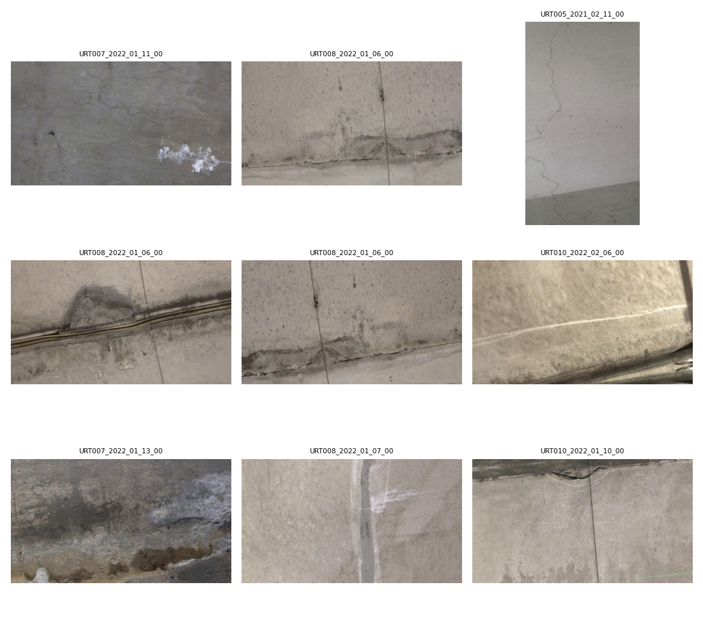

- **출처**: AI Hub의 지하 콘크리트 구조물 영상을 논문 저자들이 세 클래스로 다시 정의해 폴리곤으로 주석한 데이터셋이다. YOLO segmentation 포맷(라벨 한 줄 = 클래스 ID + 0~1로 정규화한 폴리곤 좌표)이고 train/val/test 분할까지 끝난 상태로 받았다. 영상은 대부분 1920×1080이다.
- **규모**: 아래 표. 영상 수 외의 숫자는 인스턴스(폴리곤) 수다.

  | | 영상 | 원본 수 | crack | efflorescence | spall_detach |
  |---|---|---|---|---|---|
  | train 배포본 | 4,036 | – | 1,088 | 1,783 | 2,697 |
  | **train 정리 후 (학습에 쓴 것)** | **3,890** | 119 | 1,044 | 1,768 | 2,592 |
  | val | 40 | 40 | 10 | 27 | 16 |
  | test | 40 | 40 | 14 | 19 | 14 |

  train은 원본 119장과 그 증강본(회전·뒤집기 등)이고, val·test는 증강 없는 원본만이다. 이미지 단위로 보면 정답 ON 영상은 val이 crack 10 · efflorescence 17 · spall_detach 13장, test가 13 · 13 · 14장이다.

- **train에서 146장을 뺀 이유** (논문은 4,036장, 여기는 3,890장): 강의 자료는 이 데이터셋에 누수와 중복이 없다고 전제하지만, 직접 점검하니 세 가지 문제가 train에 있었다. val·test는 손대지 않았다.

  | 문제 | 장수 | 내용 | 조치 |
  |---|---|---|---|
  | 누수 | 55 | 원본 `URT017_2020_02_08_001_24512`가 test에 1장, train에 원본 1장 + 증강본 54장으로 같이 들어 있었다 | train 쪽 55장 제외 |
  | 중복 | 28 | 내용(md5)이 완전히 같은 영상 27묶음. 증강 스크립트가 같은 변환을 두 번 저장한 것 | 묶음마다 한 장만 남김 |
  | 빈 파일 | 63 | 영상 파일 크기가 0바이트 | 제외 |

  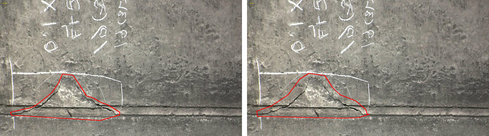

  왼쪽이 train의 원본, 오른쪽이 test에 들어 있던 같은 사진이다(빨간 선은 각자의 spall_detach 폴리곤). 같은 원본에서 나온 영상이 train과 test에 나뉘어 있으면 테스트 점수가 부풀려지므로 "같은 원본은 같은 split" 원칙에 따라 train 쪽을 뺐다. 뺀 파일 목록은 [docs/excluded_train_files.csv](docs/excluded_train_files.csv)이고, 점검은 `scripts/check_data.py`가 한다.

- **원본 단위 분할**: 분할은 배포본 그대로 쓰고, 그것이 원칙을 지키는지만 확인했다. 파일 이름에서 Roboflow 접미사(`_jpg.rf.<해시>`)와 증강 꼬리(`_aug…`, `_efflo_…`)를 떼어 원본 ID를 만들고, 한 원본 ID가 두 split에 나타나지 않는지 검사한다. 위 146장을 뺀 뒤에는 겹치는 원본이 없다(train 119 · val 40 · test 40).
- **주석 기준 요약**: 데이터가 이미 주석되어 있어서, 증강본을 뺀 원본 198장의 라벨을 모두 보고 주석자가 따른 규칙을 거꾸로 정리했다. 전문은 [annotation_guideline.md](scripts/report/week_1/annotation_guideline.md).
  - crack은 균열선을 가운데 두고 여유를 둔 띠로 감싼다(폴리곤 폭 약 40 px, 실제 균열 폭은 수 px). efflorescence는 침착물의 들쭉날쭉한 경계를 따라간다. spall_detach는 패인 곳과 들뜬 조각을 함께 감싼다.
  - 제외 대상: 시공 이음부, 케이블·배관, 그림자, 조명 정반사, 보수재 띠, 누수 얼룩, 점검자의 분필 표시. 예시는 `scripts/report/week_1/component/hard_negatives.png`.
  - **한 영상에는 한 클래스만 라벨되어 있다.** 전체 데이터에서 두 클래스 이상 라벨된 영상이 한 장도 없다. 그래서 박락 영상에 균열이 보여도 crack 라벨은 없고, 모델이 그 균열을 찾으면 평가에서는 오탐이 된다(3절, 4절 한계 2).
- **직접 주석 연습**: CVAT로 15장을 직접 폴리곤 주석해 YOLO seg 포맷으로 내보냈다(`practice_polygon/output/`). 과정을 익히는 연습이고, 배포 라벨과 기준이 섞이지 않도록 학습에는 쓰지 않았다.
- **전처리와 증강**: 종횡비를 유지한 채 960으로 줄이고 남는 곳은 letterbox로 채운다. Mosaic와 MixUp은 껐다(1.3절). 그 밖의 증강(좌우 뒤집기, 색·밝기, 이동·크기)은 ultralytics 기본값이고 학습셋에만 적용된다.

### 1.3 사용한 모델

**YOLOv8n-Seg**(`yolov8n-seg.pt` 사전학습 가중치를 3클래스로 미세조정). Backbone이 여러 크기의 특징을 뽑고, Neck이 이를 합치고, Detection head가 박스와 클래스를, Segmentation branch가 인스턴스 마스크를 낸다. 파라미터 약 339만 개, 가중치 파일 7 MB다.

| 설정 | 값 | 논문과 |
|---|---|---|
| 모델 | YOLOv8n-Seg | **다름** (논문 YOLOv8s-Seg) |
| 입력 크기 | 960 | 동일 |
| 배치 | 4 | 동일 |
| 옵티마이저 / 초기 학습률 | AdamW / 0.00015 | 동일 |
| epoch | 60 (patience 20) | 동일 |
| Mosaic / MixUp | 0.0 / 0.0 | 동일 |
| seed | 42 | – |
| 장치 | Apple M4 MPS | 다름 (논문 CUDA GPU) |

- **small 대신 nano를 쓴 이유**: Apple M4(MPS, 메모리 16 GB)에서 small은 60 epoch에 13~14시간이 걸리는 것으로 추정되어, 학습 시간이 너무 길어 한 단계 작은 모델로 낮췄다. 나머지 설정은 논문과 같다.
- **입력 960의 근거**: 균열은 폭이 몇 픽셀이라 영상을 작게 줄이면 사라진다. 세부를 남기려고 크게 넣고, 그 대신 배치를 4로 줄인다.
- **Mosaic·MixUp을 끈 근거**: Mosaic는 네 영상을 잘라 붙여 콘크리트 표면의 공간적 맥락을 깨고, MixUp은 두 영상을 겹쳐 결함 경계를 물리적으로 의미 없게 만든다. 일반 물체 검출에서는 표준이지만 결함 경계를 배워야 하는 이 문제에는 맞지 않는다.

### 1.4 학습 및 테스트 방법

**학습** (`scripts/train.py`). 60 epoch로 설정했고, 검증 성능이 20 epoch 동안 나아지지 않아 **31 epoch에서 조기 종료**됐다(214분). `best.pt`는 검증 성능이 가장 높았던 epoch의 가중치이며, patience 20으로 31에서 멈췄으므로 11번째 epoch이다(검증 mask mAP50 0.630, mAP50-95 0.237).

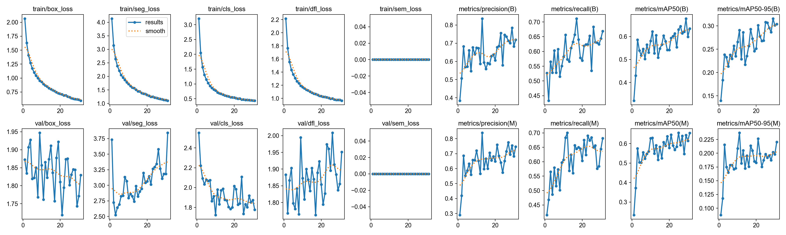

학습 손실은 꾸준히 줄었지만(seg loss 4.14 → 1.10), 검증 손실은 3 epoch에서 최저(2.52)를 찍은 뒤 오르내리며 올라갔고 검증 mAP도 0.50~0.66 사이에서 흔들렸다. 그래서 마지막 epoch이 아니라 검증 성능이 가장 높은 epoch의 가중치를 쓴다. 검증셋이 40장뿐이라 epoch 간 요동이 큰 것도 감안해야 한다.

**평가** (`scripts/week_3.ipynb`, 위에서 아래로 실행).

| 단계 | 하는 일 | 쓰는 데이터 |
|---|---|---|
| 1 | `model.val`로 mask mAP50 · mAP50-95 산출 | test |
| 준비 | 라벨 파일에서 영상별 정답 클래스 집합을 만들고, 영상마다 **한 번만** 추론해 예측(클래스, 신뢰도)을 저장 | val |
| 2 | ON/OFF 채점 함수 `onoff` 작성, 임계값 0.5로 동작 확인 | val |
| 3 | 임계값 후보 10개로 클래스별 F1을 구해 최고점을 선택 (동점이면 낮은 값) | **val만** |
| 4 | 테스트셋을 처음 추론하고, 3에서 정한 임계값을 그대로 적용 | test |
| 5 | 틀린 영상(FP·FN)을 정답·예측과 함께 저장 | test |

- **ON/OFF 판정**: 정답 ON = 그 클래스 라벨이 영상에 하나라도 있다. 예측 ON = 그 클래스 예측 중 신뢰도가 임계값 이상인 것이 하나라도 있다. 클래스별로 TP·FP·FN·TN을 세어 precision · recall · F1을 내고, 세 클래스 F1의 평균이 macro F1이다.
- **임계값 절차**: 테스트셋 추론은 임계값이 `best`에 확정된 다음 셀에서 처음 이루어지고, 단계 4는 후보를 훑지 않고 `best[name]` 하나만 넣는다. 테스트 결과를 본 뒤 임계값이나 후보를 고치지 않았다.
- **강의 코드와 다르게 한 것**
  - 강의 코드는 임계값마다 `model.predict`를 다시 돌린다. `predict`의 기본 신뢰도 하한이 0.25라서 그대로 쓰면 0.25보다 낮은 후보들은 남는 예측이 같아 결과가 전부 같아진다. 그래서 `conf=0.001`(후보 중 가장 낮은 값)로 영상마다 한 번만 추론해 저장해 두고 임계값만 바꿔 가며 셌다. 판정 규칙은 같다.
  - 임계값 후보는 강의의 8개(0.001~0.3)에 0.4와 0.5를 더한 10개다. 곡선이 높은 쪽에서 꺾이는 것까지 보려는 것이고, 테스트셋을 보기 전에 정했다. 고른 값은 8개만 썼을 때와 같다.
  - 오류 사례 그림에는 클래스별 임계값 이상인 예측만 그렸다(강의 코드는 기본값 0.25로 그려서, ON 판정의 근거가 된 낮은 신뢰도 예측이 그림에 안 나올 수 있다).

### 1.5 실행 방법

```bash
# 0) 환경 (Python 3.12)
python -m venv .venv && source .venv/bin/activate
pip install -r requirements.txt

# 1) 데이터: 강의에서 배포한 yolo_seg_3_clean_v4_2 를 data/ 에 푼다 (data/images, data/labels).
#    data/data.yaml 은 저장소에 있는 것을 쓴다.

# 2) train에서 146장 제외 (누수·중복·빈 파일)
cd data && for s in $(tail -n +2 ../docs/excluded_train_files.csv | cut -d, -f1); do rm -f images/train/$s.jpg labels/train/$s.txt; done; cd ..

# 3) 데이터 무결성 점검 → "결과: 문제 없음" 이 나와야 한다
python scripts/check_data.py

# 4) 학습 → runs/full/weights/best.pt  (Apple M4 MPS에서 약 3.6시간. 다른 장치는 train.py의 device 수정)
python scripts/train.py

# 5) 평가: scripts/week_3.ipynb 를 위에서 아래로 실행 (약 1분)
#    → scripts/report/week_3/component/ 에 F1 곡선, 결과표, 오류 사례 저장
```

`best.pt`와 `runs/`, `data/`는 용량 때문에 저장소에 없다. 평가 결과(그림·표)는 `scripts/report/week_3/component/`에 들어 있어 실행하지 않고도 확인할 수 있다.

### 1.6 코드 파일 설명

| 파일 | 설명 |
|---|---|
| `scripts/check_data.py` | 데이터 무결성 점검 7종: data.yaml, 영상–라벨 대응, 라벨 형식, 영상 읽기, val·test 증강 여부, 원본 단위 분할, 중복 영상. [mermaid](scripts/mermaid/check_data.md) |
| `scripts/train.py` | YOLOv8n-Seg 학습. 설정은 1.3절 표. 학습 시간을 결과 폴더에 저장. [mermaid](scripts/mermaid/train.md) |
| `scripts/week_1.ipynb` | 1주차 실습 노트북 (영상과 라벨 관찰) |
| `scripts/week_2.ipynb` | 2주차 실습 노트북 (학습 곡선) |
| `scripts/week_3.ipynb` | 3주차: mask mAP, ON/OFF 평가, 검증셋 임계값 탐색, 테스트셋 고정 적용, 오류 사례 저장 (1.4절) |
| `data/data.yaml` | 데이터 설정 (세 split 경로, 클래스 이름) |
| `docs/decisions.md` | 강의 자료와 다르게 정했거나 새로 정한 것의 기록 |
| `docs/excluded_train_files.csv` | train에서 뺀 146장 목록과 이유 |
| `scripts/report/week_1/` | 주석 기준서(`annotation_guideline.md`), 1주차 리포트, 라벨 예시·하드 네거티브 그림 |
| `scripts/report/week_2/` | 2주차 리포트, 점검 출력, 시험 학습 곡선 |
| `scripts/report/week_3/component/` | `val_threshold_f1.png`·`.csv`(임계값별 F1), `test_onoff.csv`(결과표), `test_errors.csv`와 `error_cases/`(오류 사례), `test_mask_pr_curve.png`, `train_results.png` |
| `practice_polygon/output/` | CVAT 직접 주석 연습 15장의 라벨 |

---

## 2. 결과

### 2.1 세그멘테이션 성능 (제출물 ③)

테스트셋 40장, 인스턴스 47개. `best.pt`를 `model.val(split="test", imgsz=960)`로 평가했다.

| 클래스 | 인스턴스 | mask Precision | mask Recall | **mask mAP50** | **mask mAP50-95** | box mAP50 |
|---|---|---|---|---|---|---|
| 전체 | 47 | 0.633 | 0.569 | **0.615** | **0.285** | 0.630 |
| crack | 14 | 0.457 | 0.542 | 0.407 | 0.111 | 0.501 |
| efflorescence | 19 | 0.768 | 0.522 | 0.641 | 0.345 | 0.593 |
| spall_detach | 14 | 0.673 | 0.643 | 0.797 | 0.399 | 0.797 |

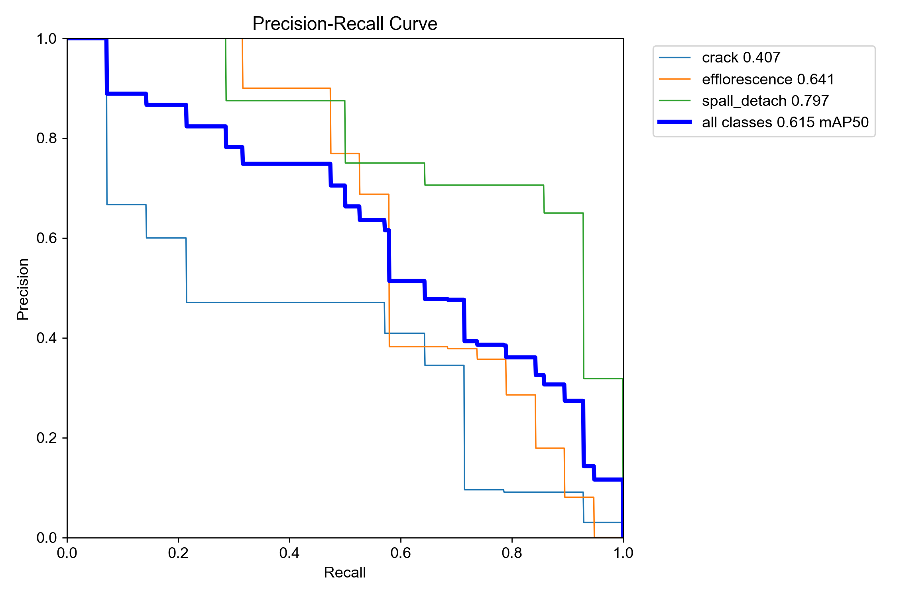

- **crack이 가장 낮다.** mAP50 0.407이고, 겹침 기준이 엄격해지는 mAP50-95에서는 0.111로 4분의 1 수준이 된다. 균열은 폭이 몇 픽셀이라 예측이 조금만 어긋나도 IoU가 크게 떨어진다. crack만 box mAP50(0.501)이 mask mAP50(0.407)보다 눈에 띄게 높은 것도 같은 이유로, 위치는 대체로 맞지만 가는 띠 모양의 마스크가 정답과 겹치지 않는 경우가 있다는 뜻이다.
- **spall_detach가 가장 높다**(0.797). 덩어리가 크고 경계가 뚜렷한 편이다. efflorescence는 그 사이(0.641)로, 정밀도는 가장 높지만(0.768) 재현율이 낮다(0.522). 옅거나 퍼진 침착물을 놓친다.
- **전체 mAP50 0.615에서 mAP50-95 0.285로 절반 아래로 떨어진다.** 대략적인 위치와 범위는 맞히지만 엄격한 경계 정확도는 맞히지 못한다는 뜻이고, 논문(0.443 → 0.222)과 같은 양상이다.
- 논문보다 수치가 높지만 모델 크기, 학습 데이터, 라이브러리 버전이 달라 우열을 말할 수 없다. 인스턴스가 클래스당 14~19개뿐이라 한두 개가 점수를 크게 움직인다.

### 2.2 검증셋 임계값 탐색 (제출물 ④)

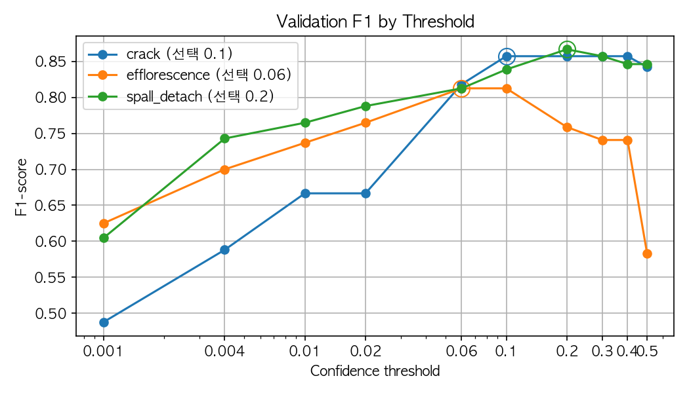

검증셋 40장에서 임계값 후보마다 구한 F1 (괄호는 FP / FN). 굵은 칸이 선택한 값이다.

| 임계값 | crack | efflorescence | spall_detach |
|---|---|---|---|
| 0.001 | 0.488 (21 / 0) | 0.625 (16 / 2) | 0.605 (17 / 0) |
| 0.004 | 0.588 (14 / 0) | 0.700 (9 / 3) | 0.743 (9 / 0) |
| 0.01 | 0.667 (10 / 0) | 0.737 (7 / 3) | 0.765 (8 / 0) |
| 0.02 | 0.667 (8 / 1) | 0.765 (4 / 4) | 0.788 (7 / 0) |
| 0.06 | 0.818 (3 / 1) | **0.812 (2 / 4)** | 0.813 (6 / 0) |
| 0.1 | **0.857 (2 / 1)** | 0.812 (2 / 4) | 0.839 (5 / 0) |
| 0.2 | 0.857 (2 / 1) | 0.759 (1 / 6) | **0.867 (4 / 0)** |
| 0.3 | 0.857 (2 / 1) | 0.741 (0 / 7) | 0.857 (3 / 1) |
| 0.4 | 0.857 (2 / 1) | 0.741 (0 / 7) | 0.846 (2 / 2) |
| 0.5 | 0.842 (1 / 2) | 0.583 (0 / 10) | 0.846 (2 / 2) |

선택한 임계값과 그 지점의 검증 성능:

| | crack | efflorescence | spall_detach |
|---|---|---|---|
| **선택 임계값** | **0.10** | **0.06** | **0.20** |
| Precision | 0.818 | 0.867 | 0.765 |
| Recall | 0.900 | 0.765 | 1.000 |
| F1 | 0.857 | 0.812 | 0.867 |
| FP / FN | 2 / 1 | 2 / 4 | 4 / 0 |

- **선택 근거**: 클래스별로 F1이 가장 높은 후보를 골랐고, 동점이면 낮은 값을 골랐다(놓치는 결함을 줄이는 쪽). crack은 0.1~0.4가 모두 0.857로 동점이라 0.1을, efflorescence는 0.06과 0.1이 동점이라 0.06을 골랐다. spall_detach는 0.2가 단독 최고이고 미탐이 0인 가장 높은 임계값이기도 하다.
- **세 클래스의 정점이 다르다.** efflorescence는 0.06~0.1에서 정점을 찍고 임계값을 올리면 빠르게 무너진다(0.5에서 17장 중 10장을 놓침). 모델이 백태에 신뢰도를 낮게 주기 때문이다. spall_detach는 0.2까지 오르고 높은 임계값에서도 버틴다. crack은 0.1 이상에서 평평하다.
- **임계값을 낮추면 FN이 줄고 FP가 는다.** crack은 0.001에서 FP 21 · FN 0, 0.5에서 FP 1 · FN 2다.
- **클래스별 임계값의 이득은 검증셋에서 크지 않았다.** 세 클래스에 같은 값을 쓴다면 0.1이 가장 좋고 검증 macro F1이 0.836이다. 클래스별로 고르면 0.845로 차이가 0.009인데, 이는 영상 한 장이 만드는 차이보다 작다. 반면 흔히 쓰는 0.5를 그대로 썼다면 0.757이다. 즉 이 모델에서는 "클래스마다 다르게"보다 "기본값보다 훨씬 낮게"가 더 큰 차이를 만든다.
- 논문의 임계값(0.010 / 0.004 / 0.060)보다 전부 높다. 모델이 달라 신뢰도 분포가 다른 것이고, 임계값은 모델마다 검증셋에서 새로 정해야 하는 값이다.

### 2.3 테스트셋 ON/OFF 결과 (제출물 ⑤)

검증셋에서 정한 임계값을 그대로 적용했다. 테스트셋 40장.

| 클래스 | 임계값 | TP | FP | FN | TN | Precision | Recall | F1 |
|---|---|---|---|---|---|---|---|---|
| crack | 0.10 | 11 | 1 | 2 | 26 | 0.917 | 0.846 | 0.880 |
| efflorescence | 0.06 | 13 | 3 | 0 | 24 | 0.812 | 1.000 | 0.897 |
| spall_detach | 0.20 | 13 | 2 | 1 | 24 | 0.867 | 0.929 | 0.897 |
| **macro** | | | | | | 0.865 | 0.925 | **0.891** |

- **세 클래스 모두 F1 0.88 이상이다.** 결함이 있는 영상 40건(13 + 13 + 14) 중 37건을 찾았고(FN 3), 없는 영상 80건 중 6건을 잘못 ON으로 판정했다(FP 6).
- **mask mAP와의 대비**: crack은 mask mAP50이 0.407로 가장 낮지만 ON/OFF F1은 0.880이다. 경계가 어긋나도 "이 영상에 균열이 있다"는 판정은 맞는다. 점검 영상에서 결함 가능성이 있는 것을 먼저 골라내는 용도라면 이 성능으로 쓸 수 있고, 균열의 정확한 범위나 폭을 재는 용도로는 부족하다.
- **클래스별 성격**: crack은 정밀도가 높고 재현율이 낮다(놓친 2장). efflorescence는 반대로 전부 찾았지만 FP가 3장으로 가장 많다. 임계값 0.06이 낮아서 생기는 교환이다.
- **검증 0.845 → 테스트 0.891.** 검증셋에서 정한 임계값이 테스트셋에서 무너지지 않았다. 다만 두 셋 모두 40장이라, 테스트가 더 높게 나온 것 자체는 표본 차이로 봐야 한다. 영상 한 장이 클래스 F1을 0.03~0.04 움직인다.

---

## 3. 오류 분석 (제출물 ⑥)

테스트셋의 오류는 모두 9건이다(FP 6, FN 3). 전체 목록은 `scripts/report/week_3/component/test_errors.csv`. 아래 그림은 **왼쪽이 정답 폴리곤**(crack 빨강, efflorescence 초록, spall_detach 파랑), **오른쪽이 예측**(클래스별 임계값 이상인 것만)이다.

### crack — FN 2, FP 1

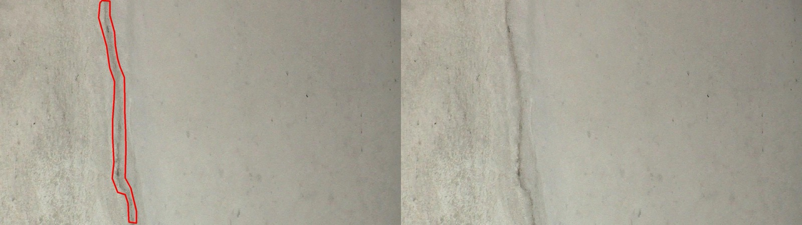

**FN** (crack 예측의 최고 신뢰도 0.012). 매끈한 면에 난 흐릿한 선으로, 주변과 밝기 차이가 거의 없다. 예측이 하나도 채택되지 않았다. **낮은 대비**가 원인이다.

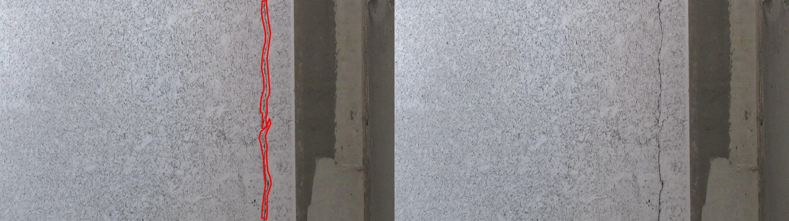

**FN** (최고 신뢰도 0.035). 가는 균열이 얼룩덜룩한 표면 질감에 묻혔다. 선 자체는 사람 눈에 보이지만 폭이 좁고, 표면 전체에 비슷한 어두운 점이 깔려 있다. **좁은 폭과 배경 질감**이 원인이다.

두 FN 모두 신뢰도가 0.012, 0.035로 낮아 임계값을 조금 낮춰서 잡을 수 있는 경우가 아니다(0.01까지 낮추면 검증셋 FP가 2 → 10으로 는다). 모델이 사실상 보지 못한 것이다.

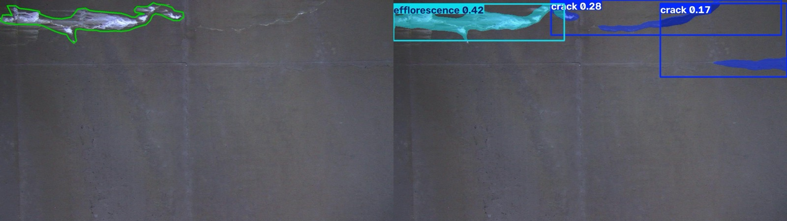

**FP** (신뢰도 0.28, 정답 라벨은 efflorescence). 백태 덩어리 오른쪽으로 이어지는 가는 흰 선을 crack으로 예측했다. 이 선은 균열을 따라 백태가 낀 것으로 보이며, 그렇다면 모델이 틀렸다기보다 **라벨에 없는 균열을 찾은 경우**다. 이 데이터는 영상마다 한 클래스만 라벨했기 때문에(1.2절) 이런 예측은 평가에서 오탐으로 셈된다.

### efflorescence — FN 0, FP 3

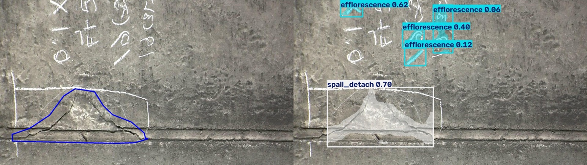

**FP** (신뢰도 0.62, 정답 라벨은 spall_detach). **점검자가 분필로 쓴 글씨**를 백태로 예측했다. 흰색이고 콘크리트 위에 얹혀 있다는 점이 백태와 같다. 1주차 주석 기준서에서 제외 대상으로 적은 하드 네거티브가 실제 오탐으로 나타난 사례이고, 신뢰도가 0.62로 높아 임계값으로는 걸러지지 않는다.

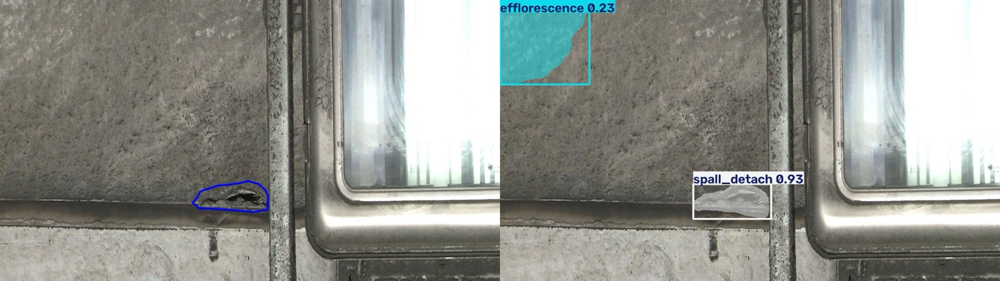

**FP** (신뢰도 0.23, 정답 라벨은 spall_detach). 조명 기구 옆의 **밝게 비친 거친 벽면**을 백태로 예측했다. 침착물은 없고 조명 때문에 밝아진 표면이다.

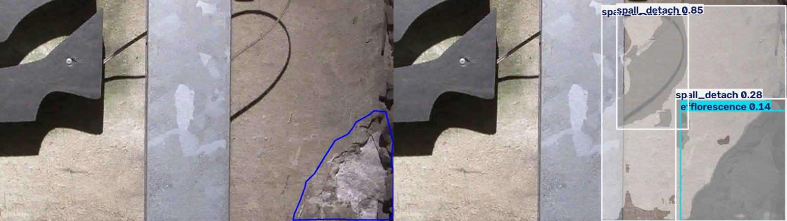

**FP** (신뢰도 0.14, 정답 라벨은 spall_detach). 박락으로 **드러난 밝은 면**을 백태로도 예측했다(같은 영역을 spall_detach 0.28로도 예측).

세 건 모두 "밝거나 흰 것"을 백태로 본 경우다. 모델이 백태를 **색과 밝기에 크게 기대어** 판단한다는 신호이고, 논문이 든 백태 오탐 원인(정반사, 밝은 보수 재료, 표면 오염)과 같은 계열이다. 임계값 0.06이 낮아 신뢰도 0.14, 0.23짜리 예측도 ON이 된 것이며, 그 대가로 백태 FN은 0이다.

### spall_detach — FN 1, FP 2

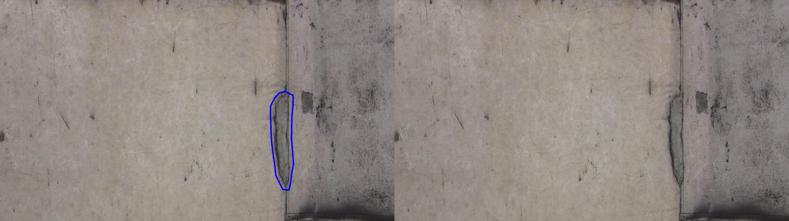

**FN** (최고 신뢰도 0.174). 이음부 옆의 얕고 길쭉한 박락으로, 패인 깊이가 얕아 그림자가 거의 없고 주변과 색이 비슷하다. 모델은 이 영역을 찾았지만 신뢰도가 임계값 0.2에 조금 못 미쳤다. **배경과 비슷한 질감, 초기 단계의 박락**이 원인이다.

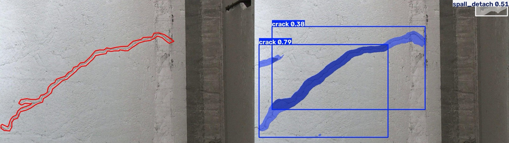

**FP** (신뢰도 0.51, 정답 라벨은 crack). 영상 오른쪽 위, **구조물 모서리의 어두운 틈**을 박락으로 예측했다. 패인 것처럼 보이는 구조물 형상이다. 같은 영상의 균열은 0.79로 맞게 찾았다.

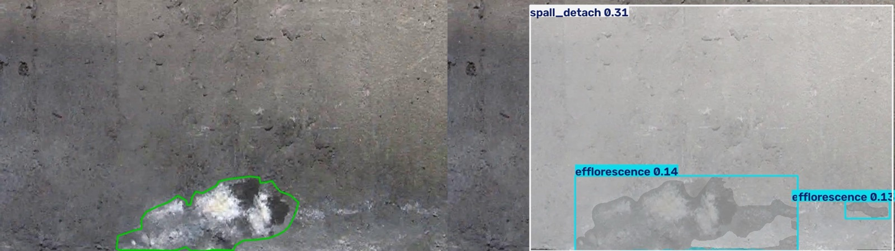

**FP** (신뢰도 0.31, 정답 라벨은 efflorescence). 영상 거의 전체를 덮는 큰 박스로 spall_detach를 예측했다. 특정 결함을 가리키는 예측이 아니고, 거칠고 얼룩진 표면 전체에 반응한 것으로 보인다.

### 정리

| 클래스 | 미탐 원인 | 오탐 원인 |
|---|---|---|
| crack | 낮은 대비, 좁은 폭, 얼룩진 배경 질감 | 백태가 낀 선형 흔적 (라벨에 없는 균열일 가능성) |
| efflorescence | (없음) | 분필 표시, 조명에 밝아진 면, 박락으로 드러난 밝은 면 |
| spall_detach | 얕고 대비가 낮은 박락 | 구조물 모서리의 틈, 거친 표면 전체 |

- **FP 6건을 "모델이 틀린 것"과 "라벨이 빠진 것"으로 나누면 5건과 1건이다.** 한 영상 한 클래스 라벨 때문에 crack 정밀도가 실제보다 낮게 나올 것을 걱정했는데, 해당하는 것은 crack FP 1건뿐이었다. 다만 crack FP가 그 1건이 전부이므로, 그것을 빼면 테스트셋에서 crack 오탐은 없는 셈이다.
- **FP 6건은 모두 다른 클래스가 라벨된 영상에서 나왔다.** 테스트셋에는 결함이 전혀 없는 영상이 없어서, 깨끗한 콘크리트 면에서의 오탐률은 이 평가로 알 수 없다.
- **개선 방향**: 백태 오탐은 분필 표시와 조명 반사를 하드 네거티브(라벨 없는 배경 영상)로 학습셋에 넣는 것, crack 미탐은 영상을 타일로 나눠 고해상도로 추론하는 것이 논문이 제안한 방향과 맞는다. 이번 과제에서는 하지 않았다.

---

## 4. 최종 결과

- **세그멘테이션**: 테스트 mask mAP50 0.615, mAP50-95 0.285. spall_detach 0.797 > efflorescence 0.641 > crack 0.407 순이다.
- **이미지 단위 선별**: 검증셋에서 정한 클래스별 임계값(0.10 / 0.06 / 0.20)을 테스트셋에 그대로 적용해 macro F1 0.891. 세 클래스 모두 F1 0.88 이상이다.
- **두 평가의 관계**: 마스크 점수가 가장 낮은 crack도 선별 F1은 0.880이다. 경계 정확도의 한계와 별개로, 결함이 있는 영상을 골라내는 성능은 안정적이었다.
- **오류**: 9건 중 백태 오탐 3건이 가장 큰 묶음이고 원인이 모두 "밝거나 흰 것"이다. 균열 미탐 2건은 신뢰도가 0.04 이하라 임계값으로 해결되지 않는다.

### 논문·강의 자료와 다르게 한 점

| 항목 | 논문·강의 | 본 실습 | 이유 |
|---|---|---|---|
| 모델 | YOLOv8s-Seg | YOLOv8n-Seg | MPS에서 small은 13~14시간 추정 |
| train 영상 | 4,036장 | 3,890장 | 누수 55 · 중복 28 · 빈 파일 63장 제외 (1.2절) |
| 주석 기준서 | 기준을 정하고 주석 | 기존 라벨을 보고 규칙을 정리 | 데이터가 이미 주석되어 있었음 |
| ON/OFF 추론 | 임계값마다 다시 추론 | `conf=0.001`로 한 번 추론해 저장 | `predict` 기본 하한 0.25 때문에 낮은 후보가 구분되지 않음 |
| 임계값 후보 | 8개 (0.001~0.3) | 10개 (0.4, 0.5 추가) | 곡선이 꺾이는 구간까지 확인 |
| 제출 형식 | PDF 리포트 | 이 README | – |

전체 기록은 [docs/decisions.md](docs/decisions.md).

### 논문과 결과가 다르게 나온 이유

논문과 비교하면 이미지 단위 ON/OFF 결과는 비슷하고, 마스크 점수와 임계값은 다르다.

| 항목 | 논문 (YOLOv8s-Seg) | 본 실습 (YOLOv8n-Seg) | 판단 |
|---|---|---|---|
| 테스트 macro F1 | 0.896 | 0.891 | 비슷함 |
| 클래스별 F1 (crack / efflorescence / spall_detach) | 0.880 / 0.880 / 0.929 | 0.880 / 0.897 / 0.897 | 비슷함 |
| 테스트 오류 (FP / FN) | 3 / 5 | 6 / 3 | 합계는 비슷하고 구성이 다름 |
| 테스트 mask mAP50 | 0.443 | 0.615 | 다름 |
| 테스트 mask mAP50-95 | 0.222 | 0.285 | 다름 |
| 검증셋에서 고른 임계값 | 0.010 / 0.004 / 0.060 | 0.10 / 0.06 / 0.20 | 3~15배 다름 |

**ON/OFF 결과는 같다고 본다.** 테스트셋이 40장이라 영상 한 장이 클래스 F1을 0.03~0.04 움직인다. macro F1 차이 0.005는 그보다 작다. 오류 수도 논문 8건, 본 실습 9건으로 한 건 차이다. 다만 논문은 미탐이 더 많고 본 실습은 오탐이 더 많다. 본 실습의 임계값이 F1 동점 구간에서 낮은 값으로 정해져 결함을 놓치지 않는 쪽으로 기울었기 때문일 수 있다.

**mask mAP50은 더 작은 모델인데도 0.17 높게 나왔다.** 이 차이는 작지 않지만 "nano가 small보다 낫다"는 뜻으로 읽을 수 없다. 원인을 하나로 가려내는 실험은 하지 않았고, 가능한 원인은 다음과 같다.

1. **테스트셋이 작다.** mask mAP는 클래스당 인스턴스 14~19개로 계산되어 예측 몇 개에 크게 흔들린다. 같은 모델을 seed만 바꿔 다시 학습해도 값이 꽤 달라질 수 있는데, 본 실습과 논문 모두 그 편차를 알 수 없다.
2. **학습 조건이 여러 가지 함께 다르다.** 모델 크기(s → n), 학습 데이터(146장 제외), 라이브러리 버전(ultralytics 8.4.212), 학습 장치(MPS), 멈춘 시점(31 epoch에서 조기 종료)이 모두 달라서 어느 것의 영향인지 나눌 수 없다. 학습 데이터 3,890장은 원본 119장의 증강본이라, 파라미터가 적은 모델이 덜 과적합했을 가능성도 있으나 확인하지 않았다.
3. **논문의 계산 조건을 모두 알지 못한다.** 논문의 0.443이 어떤 추론 설정(신뢰도 하한, 입력 크기, 선택한 가중치)에서 나온 값인지 강의 자료만으로는 확인할 수 없다. 본 실습의 값은 `model.val(split="test", imgsz=960)`의 기본 설정으로 낸 것이다.
4. **누수 제거는 원인이 아니다.** 본 실습은 테스트셋과 겹치는 원본의 영상 55장을 학습셋에서 뺐다. 이것은 테스트 점수를 낮추는 방향이므로 점수가 높게 나온 것을 설명하지 못한다.

**임계값은 클래스에 따라 3~15배 높게 정해졌다.** 임계값은 모델이 내는 신뢰도의 분포에 맞춰 정해지는 값이고, 모델과 학습이 달라지면 신뢰도 분포도 달라진다. 두 결과 모두 기본값 0.5보다 훨씬 낮은 값이 선택되었고 클래스마다 값이 다르다는 점은 같다. 논문의 임계값을 본 실습의 모델에 그대로 가져다 쓸 수 없고, **임계값은 모델마다 검증셋에서 다시 정해야 한다**는 것을 보여 준다.

정리하면, 결함이 있는 영상을 골라내는 성능은 논문과 같은 수준으로 재현되었다. 마스크 점수의 차이는 테스트셋 크기와 여러 조건의 차이가 섞인 결과여서, 어느 모델이 더 나은지는 이 실험으로 말할 수 없다.

### 한계

1. **검증·테스트셋이 각 40장이다.** ON/OFF 평가에서 영상 한 장이 클래스 F1을 0.03~0.04 움직이고, mask mAP는 클래스당 인스턴스 14~19개로 계산된다. 임계값도 40장으로 정한 것이라 단단한 값이 아니다(crack은 0.1~0.4가 동점이었다). 여기 보고한 수치의 작은 차이에는 의미를 두기 어렵고, 다른 터널·촬영 장비·조명 조건에서의 성능은 알 수 없다.
2. **한 영상에 한 클래스만 라벨되어 있다.** 다른 클래스의 결함은 영상에 보여도 라벨이 없어서, 모델이 그것을 찾으면 오탐으로 셈된다. 테스트셋에서는 crack FP 1건이 이에 해당하는 것으로 보인다. 또 결함이 없는 영상이 평가에 없어 깨끗한 면에서의 오탐률을 잴 수 없다.
3. **배포 데이터셋의 점검이 놓친 문제가 있었다.** 배포본에 든 점검(`data/_dataset_match_check/`)과 강의의 점검 코드는 영상–라벨 이름 대응, 클래스 ID, 좌표 범위만 본다. 그래서 빈 파일(크기), 중복(내용), 누수(원본 ID)를 잡지 못했다. 세 문제 모두 train의 증강본에서만 났고, 손으로 검토된 val·test 80장에서는 발견되지 않았다. 제외 목록과 `check_data.py`로 재현할 수 있지만, 내용이 조금 다른 유사 영상까지 전부 걸러냈다고 보장하지는 못한다.
4. **모델이 논문과 다르다.** YOLOv8n-Seg는 s보다 표현력이 작다. 논문 수치와 직접 비교할 수 없고, 어느 쪽이 나은지도 이 실험으로는 말할 수 없다.
5. **학습을 한 번만 했다.** seed 42 한 번의 결과이고, 검증 mAP가 epoch마다 0.50~0.66으로 흔들리는 것을 보면 seed를 바꿨을 때의 편차도 작지 않을 것이다. 반복 학습의 평균 ± 표준편차는 내지 않았다.
6. **입력을 960으로 줄인다.** 1920×1080 영상을 절반으로 줄이므로 폭이 좁은 균열의 특징이 약해질 수 있다. crack 미탐 2건이 이와 관련 있을 수 있으나 타일 기반 고해상도 추론은 시험하지 않았다.
7. **물리 단위로 잴 수 없다.** 균열 폭, 실제 면적, 깊이, 박리 내부 상태는 이 영상과 모델로 알 수 없다. 이 시스템은 결함 후보를 먼저 보여 주는 도구이고, 최종 판단에는 현장 계측이 필요하다.
8. **단일 모델이다.** U-Net, Mask R-CNN 같은 다른 구조와 비교하지 않았고, 공통 임계값과 클래스별 임계값의 비교도 검증셋에서만 했다(2.2절).

### 전체적인 실험 결과 및 느낀 점

3주 동안 데이터 점검, 학습, 평가를 한 줄로 이어 보았다. 결과만 보면 테스트 mask mAP50 0.615, macro F1 0.891로 논문과 비슷하거나 높은 숫자가 나왔지만, 모델도 학습 데이터도 논문과 달라서 그 숫자로 무엇을 주장할 수는 없다. 확인한 것은 논문의 주장이 다른 모델에서도 같은 모양으로 나타난다는 점이다. 균열은 마스크를 정확히 그리지 못해도 균열이 있는 영상은 잘 골라냈고, 결함마다 F1이 정점을 찍는 임계값이 달랐다.

가장 크게 배운 것은 **받은 데이터를 그대로 믿으면 안 된다**는 것이다. 논문의 최종 데이터셋이고 강의 자료도 누수가 없다고 설명했지만, 원본 ID로 직접 맞춰 보니 테스트셋의 사진 한 장이 학습셋에 증강본 54장과 함께 들어 있었고, 내용이 같은 영상과 0바이트 파일도 있었다. 기존 점검 코드는 파일 이름과 좌표 범위만 봐서 이 셋을 모두 통과시켰다. 점검은 "무엇을 확인했는가"만큼 "무엇을 확인하지 않았는가"가 중요했다.

두 번째는 **라이브러리의 기본값이 실험 결과를 바꾼다**는 것이다. 강의 코드를 그대로 돌렸다면 `predict`의 기본 신뢰도 하한 0.25 때문에 임계값 후보 대부분이 같은 결과를 내고, 곡선이 평평하니 아무 값이나 골랐을 것이다. 낮은 신뢰도의 예측까지 받아 두고 나서야 임계값을 낮출 때 미탐이 줄고 오탐이 느는 것이 숫자로 보였다.

세 번째는 **절차가 숫자보다 먼저**라는 것이다. 임계값을 검증셋에서 정하고 테스트셋에는 한 번만 적용하는 규칙은, 테스트 결과가 궁금해도 먼저 보지 않고 후보를 테스트 전에 확정하는 식으로 코드 순서에 그대로 남겼다. 테스트셋이 40장뿐이라 영상 한 장에 F1이 0.03씩 움직이는 상황에서는, 숫자가 조금 높고 낮은 것보다 그 숫자를 어떻게 얻었는지가 결과를 믿을 수 있는 근거가 된다. 오류 사례를 직접 보는 것도 같은 맥락이었다. 표에서는 FP 6건이라는 숫자였던 것이, 그림으로 보니 분필 글씨와 조명 반사라는 구체적인 원인으로 바뀌었다.

---

## 5. 재현 정보

| 항목 | 값 |
|---|---|
| OS / 장치 | macOS 26.6, Apple M4 (MPS, 메모리 16 GB) |
| Python | 3.12.13 |
| 주요 패키지 | ultralytics 8.4.212, torch 2.14.0, numpy 2.4.6, pandas 3.0.3, opencv-python 5.0.0, matplotlib 3.10.8 |
| 모델 / 초기 가중치 | YOLOv8n-Seg / `yolov8n-seg.pt` |
| 학습 설정 | imgsz 960, batch 4, AdamW, lr0 0.00015, mosaic 0.0, mixup 0.0, epochs 60, patience 20 |
| Seed | 42 (`deterministic=True`) |
| 데이터 설정 | `data/data.yaml` (클래스 0 crack, 1 efflorescence, 2 spall_detach) |
| 학습 데이터 | train 3,890장 (`docs/excluded_train_files.csv`의 146장 제외), val 40장, test 40장 |
| 평가 설정 | 추론 imgsz 960, `conf=0.001`, 임계값 후보 0.001 · 0.004 · 0.01 · 0.02 · 0.06 · 0.1 · 0.2 · 0.3 · 0.4 · 0.5 |
| 실행 순서 | 1.5절: 데이터 정리 → `check_data.py` → `train.py` → `week_3.ipynb` |
| 소요 시간 | 학습 214분, 평가 약 1분 (추론 약 26 ms/장) |

`scripts/report/week_3/component/`의 그림과 표는 저장소에 포함되어 있어 실행 없이 확인할 수 있다. 원본 데이터(`data/`, 3.4 GB)와 가중치(`best.pt`)는 용량 때문에 제외했다. MPS에서는 `deterministic=True`여도 연산 순서에 따라 결과가 조금 달라질 수 있어, 다시 학습하면 수치가 정확히 같지 않을 수 있다.
