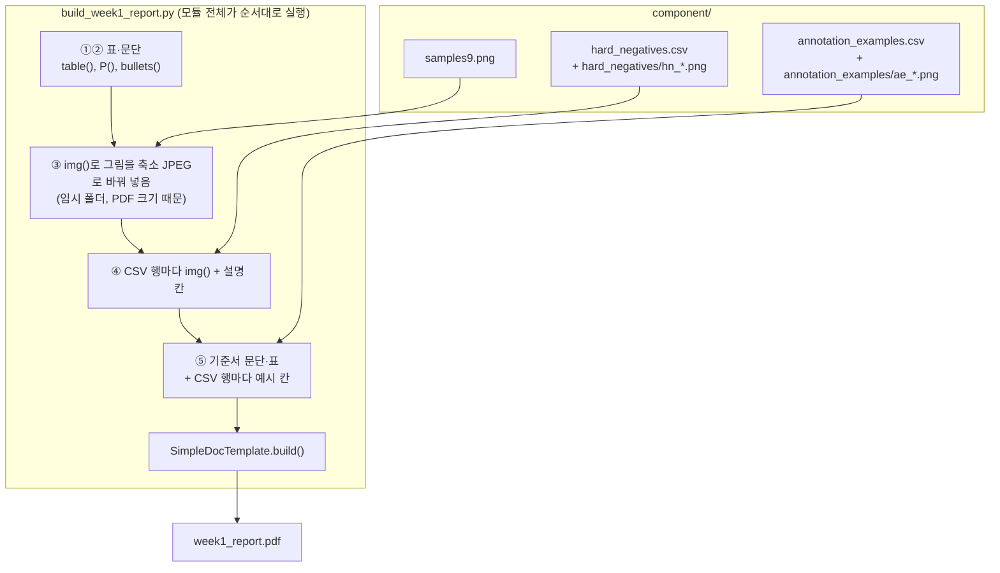

# scripts/report/week_1/build_week1_report.py

1주차 리포트 PDF(`scripts/report/week_1/week1_report.pdf`)를 만든다. 강의 1주차 20쪽의 제출물 ①~⑤를 순서대로 넣는다. 그림과 출처 표는 미리 만들어 둔 `component/` 파일을 읽고, 수치와 기준서 문장은 스크립트 안에 적혀 있다.

실행: `python scripts/report/week_1/build_week1_report.py` (macOS의 AppleGothic 글꼴을 쓴다)

## 하는 일

| 단계 | 쪽 | 내용 | 읽는 파일 |
|---|---|---|---|
| ① | 1 | 환경 확인: 기기·패키지 버전, 모델 로드 출력 | 없음 (값을 직접 적음) |
| ② | 1 | 데이터 요약: split별 영상·원본·클래스·해상도 표, 제외 146장 설명 | 없음 (값을 직접 적음) |
| ③ | 2 | 샘플 영상 9장 | `component/samples9.png` |
| ④ | 3 | 하드 네거티브 10개 표 (그림, 종류, 혼동 결함, 설명) | `component/hard_negatives.csv`, `component/hard_negatives/hn_*.png` |
| ⑤ | 4–5 | 주석 기준서 ①~⑥과 라벨 특징, 클래스별 라벨 예시 표 | `component/annotation_examples.csv`, `component/annotation_examples/ae_*.png` |

## 흐름

②의 수치와 ⑤의 기준서 문장은 `scripts/check_data.py` 출력과 `scripts/report/week_1/annotation_guideline.md`에서 옮긴 것이다. 그쪽이 바뀌면 이 스크립트의 문장도 손으로 고쳐야 한다.
