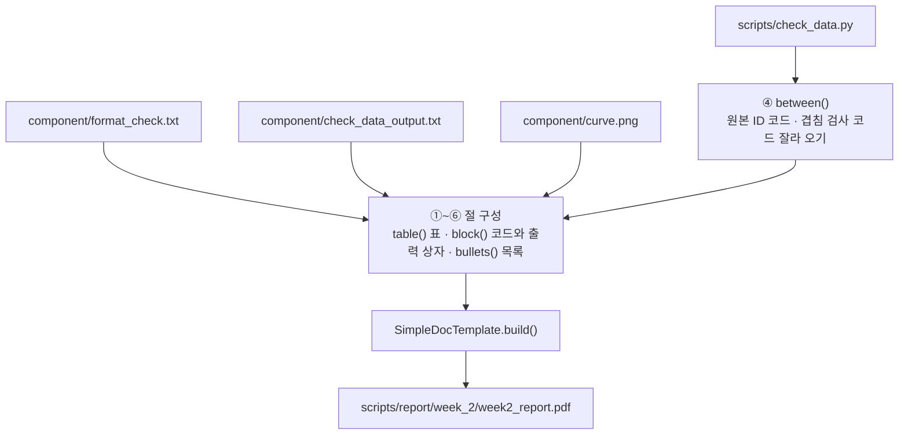

# build_week2_report.py

2주차 리포트 PDF를 만든다. 강의 2주차 17쪽의 제출물 여섯 가지만 담고, 수치와 출력은 `component/`에 저장해 둔 파일과 `check_data.py`의 실제 코드에서 가져온다.

실행: `python scripts/report/week_2/build_week2_report.py`

## 하는 일

| 단계 | 리포트 절 | 내용 |
|---|---|---|
| ① | 1. 주석 결과 | 직접 주석한 영상 수와 클래스별 인스턴스 수 표 |
| ② | 2. 포맷 확인 | 직접 주석한 라벨의 첫 줄 출력 |
| ③ | 3. 무결성 점검 | `check_data.py` 실행 출력과 이상 항목 수정 여부 |
| ④ | 4. 분할 코드 | `check_data.py`에서 원본 ID를 뽑는 코드와 split 겹침을 찾는 코드를 그대로 옮김 |
| ⑤ | 5. 학습 곡선 | `curve.png`와 3 epoch 시험 실행 수치 |
| ⑥ | 6. 설정 근거 | imgsz 960, Mosaic·MixUp 비활성화, 모델을 nano로 바꾼 이유 |

`component/`의 세 파일은 이 스크립트가 만들지 않는다. `curve.png`는 `scripts/week_2.ipynb`에서, `format_check.txt`는 강의 10쪽 코드를 `practice_polygon/output/labels/`에 돌린 출력에서, `check_data_output.txt`는 `python scripts/check_data.py`의 출력에서 나온다.

## 흐름



## 출력 예

```
저장: /Users/mac_mini/projects/detect_surface_defects/scripts/report/week_2/week2_report.pdf
```
