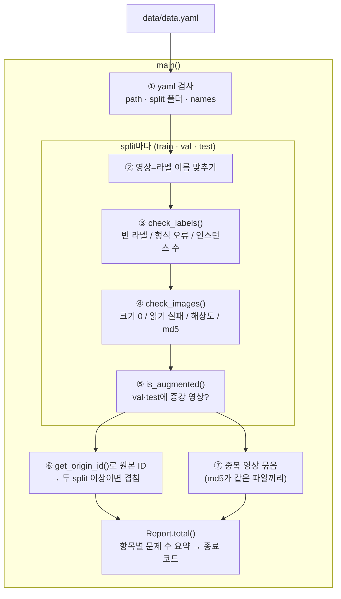
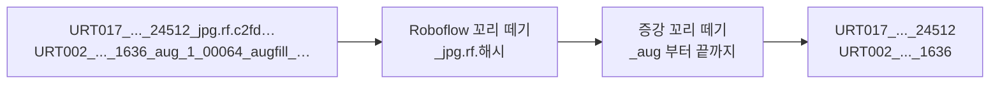

# check_data.py

데이터셋이 학습에 쓸 수 있는 상태인지 점검한다. 강의가 세운 데이터 원칙을 하나씩 검사하고, 문제가 하나라도 있으면 종료 코드 1로 끝난다.

실행: `python scripts/check_data.py` (기본 `data/`), `python scripts/check_data.py 다른/폴더`, `-v`를 붙이면 문제 파일 전체 목록을 출력

## 하는 일

함수는 네 개와 클래스 하나다. `main()`이 전체를 진행하고 라벨 검사는 `check_labels`, 영상 검사는 `check_images`, 원본 ID 뽑기는 `get_origin_id`에 맡긴다. 문제를 모아 출력하는 것은 `Report` 클래스로, `rep.problem(제목, 목록, 뜻, 조치)`를 부르면 목록이 비어 있지 않을 때만 ✗ 줄과 뜻·조치·예시 3개를 찍고 개수를 센다. `get_origin_id`와 `is_augmented`만 이 데이터셋의 파일 이름 규칙에 묶여 있고 나머지는 어느 YOLO seg 데이터셋에나 쓸 수 있다. 어느 함수가 어느 단계를 맡는지는 아래 그림에 있다.

| 단계 | 원칙 (강의 자료) | 검사 |
|---|---|---|
| ① | data.yaml이 실제 폴더와 맞는다 (2주차 14쪽) | `path`가 이 폴더인지, `train/val/test` 폴더가 있는지, `names`가 0 crack · 1 efflorescence · 2 spall_detach인지 |
| ② | 영상과 라벨이 1:1 (2주차 13쪽) | 라벨 없는 영상, 영상 없는 라벨 |
| ③ | 라벨이 YOLO seg 포맷 (2주차 11·13쪽) | 빈 라벨. 클래스 ID가 names 범위 밖, 좌표가 0~1 밖, 점이 3개 미만, 좌표 개수가 홀수이면 형식 오류 |
| ④ | 영상을 읽을 수 있다 | 크기 0, OpenCV 읽기 실패. 해상도 분포도 같이 보고 |
| ⑤ | val·test에 증강 영상 없음 (2주차 3쪽) | val·test 이름에 `_aug`가 있으면 문제 |
| ⑥ | 같은 원본은 같은 split (2주차 14쪽) | 원본 ID가 두 split 이상에 있으면 문제 |
| ⑦ | 중복 영상 없음 (2주차 9쪽, 본 강의 25쪽) | 같은 사진이 이름만 다르게 두 장 이상 있는지. 파일 내용(md5)이 완전히 같으면 한 묶음. split 무관, 출력에 `split/이름 = split/이름`으로 어느 것끼리인지 표시 |

②~④는 split마다 돌고 그때 클래스별 인스턴스 수도 출력한다. ⑥·⑦은 세 split을 합쳐서 본다.

## 흐름



각 검사는 결과 목록을 `Report.problem()`에 넘기고, `Report`가 출력 형식과 집계를 맡는다. 검사와 출력을 나눠 두어 문구를 고칠 때 검사 코드를 건드리지 않는다.

## 원본 ID 뽑기 (`get_origin_id`)

파일 이름에서 뒤에 붙은 꼬리를 두 번 뗀다.



- Roboflow 꼬리는 val·test의 일부 원본에만 붙어 있다.
- 증강 꼬리는 `_aug_…`와 `_augfill_…` 두 종류인데 둘 다 `_aug`로 시작해서 한 번에 떼진다(강의 2주차 12쪽 `stem.split("_aug")[0]`).

## 출력 예 (2026-11-07, 재다운로드 후 정리 전)

각 ✗ 아래에 뜻과 조치, 예시 3개가 붙는다. 마지막에 항목별 문제 수가 나온다.

```
=== 데이터 무결성 점검: /Users/shin/project/detect_surface_defects/data ===
✗ 가 없는 항목은 통과. 각 ✗ 아래에 뜻과 조치가 있다.

① data.yaml — 학습·평가 때 YOLO에 넘기는 데이터 설정 파일
  ✗ path가 이 폴더를 가리키지 않음: 1개
      뜻: YOLO는 path 아래에서 images/train 등을 찾는다. 지금은 다른 컴퓨터의 경로라 이 기기에서 영상을 못 찾는다.
      조치: path를 '/Users/shin/project/detect_surface_defects/data' 또는 상대 경로 '.' 로 고친다.
      - data.yaml의 path = C:/Users/rlady/Desktop/222/yolo_seg_3_clean_v4_2

②~⑤ split별 — 영상·라벨 대응, 라벨 형식, 영상 읽기, 증강 여부
[train] 영상 4036장, 라벨 4036개, 인스턴스 crack 1088 / efflorescence 1783 / spall_detach 2697, 해상도 1920x1080 3647장 · 1080x1920 326장
  ✗ 크기 0 영상: 63장
      뜻: 파일 이름은 있지만 내용이 0바이트다. ...
      조치: 원본에서 다시 받는다. 원본도 비어 있으면 영상·라벨을 함께 빼고 목록을 남긴다.
      - URT020_2021_01_12_002_779_aug_0_00944
      - ... 외 60장 (-v 로 전체 출력)
[val] 영상 40장, 라벨 40개, 인스턴스 crack 10 / efflorescence 27 / spall_detach 16, 해상도 1920x1080 40장
[test] 영상 40장, 라벨 40개, 인스턴스 crack 14 / efflorescence 19 / spall_detach 14, 해상도 1920x1080 40장

⑥ 원본 단위 분할 — 같은 사진에서 나온 영상(원본 + 증강본)은 한 split에만 있어야 한다
  원본 ID 수: train 135 · val 40 · test 40
  ✗ 여러 split에 걸친 원본 ID: 1개
      뜻: 같은 사진에서 나온 영상이 두 split에 같이 있다. ... (데이터 누수)
      조치: 한쪽 split에서 그 원본의 파일을 모두 뺀다. 테스트셋은 고정하는 것이 원칙이므로 보통 train 쪽을 뺀다.
      - URT017_2020_02_08_001_24512 -> test 1장, train 55장

⑦ 중복 영상 — 내용이 완전히 같은 사진이 두 장 이상 들어 있는지
  ✗ 중복 영상 묶음: 30묶음
      뜻: 같은 사진이 이름만 다르게 두 장 이상 들어 있다. 묶음마다 1장만 남기면 지울 수 있는 중복이 31장. ...
      조치: 묶음마다 1장만 남기고 나머지 영상·라벨을 뺀다. 뺀 목록은 남긴다.
      - train/URT002_..._augfill_00684_rot90cw = train/URT002_..._augfill_01305_rot90cw
      - ... 외 27묶음 (-v 로 전체 출력)

결과: 문제 95건
  - 크기 0 영상: 63
  - 중복 영상 묶음: 30
  - path가 이 폴더를 가리키지 않음: 1
  - 여러 split에 걸친 원본 ID: 1
```

4,061장을 다 읽고 해시하므로 약 40초 걸린다.
