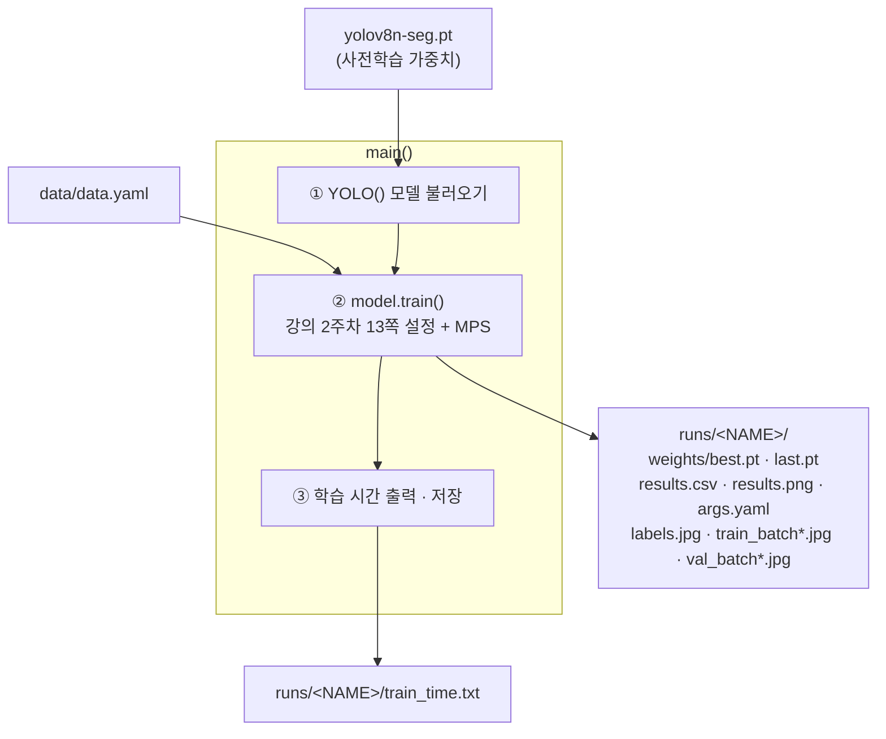

# train.py

사전학습된 YOLOv8n-Seg를 이 데이터셋으로 미세조정한다. 모델만 nano이고 나머지 설정은 강의 2주차 13쪽 그대로다. 에폭 수와 결과 폴더 이름은 파일 위쪽의 `EPOCHS`, `NAME`에서 바꾼다.

실행: `python scripts/train.py` (오래 돌릴 때는 `caffeinate -i python scripts/train.py`)

## 하는 일

| 단계 | 하는 일 |
|---|---|
| ① | 사전학습 가중치 `yolov8n-seg.pt`를 불러온다 (없으면 자동 다운로드) |
| ② | 강의 설정으로 학습한다: imgsz 960, batch 4, AdamW, lr0 0.00015, Mosaic·MixUp 끔, patience 20, seed 42, 장치는 맥의 MPS |
| ③ | 걸린 시간을 분 단위로 출력하고 결과 폴더의 `train_time.txt`에 저장한다 (3주차 리포트용) |

같은 이름의 결과 폴더가 이미 있으면 덮어쓰지 않고 `이름-2`, `이름-3`으로 새로 만든다. `train_time.txt`도 실제로 저장된 그 폴더에 들어간다. 본 학습은 `EPOCHS = 60`, `NAME = "full"`이다.

## 흐름



## 출력 예

3 epoch 시험 실행(`EPOCHS = 3`, `NAME = "step3_try"`)의 끝부분.

```
      Epoch    GPU_mem   box_loss   seg_loss   cls_loss   dfl_loss  Instances       Size
        3/3       ...      1.398      2.746      1.547      1.554        ...        960
...
학습시간 : 20.3분 (설정 3 epochs)
저장: .../runs/step3_try/train_time.txt
```
